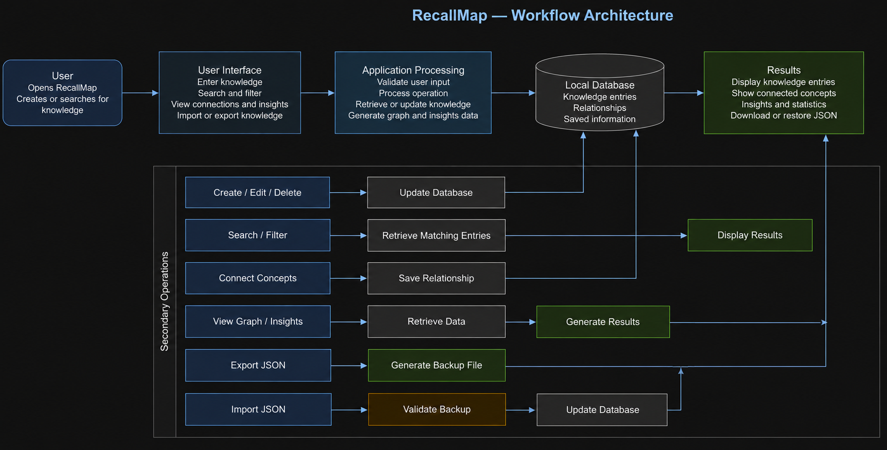
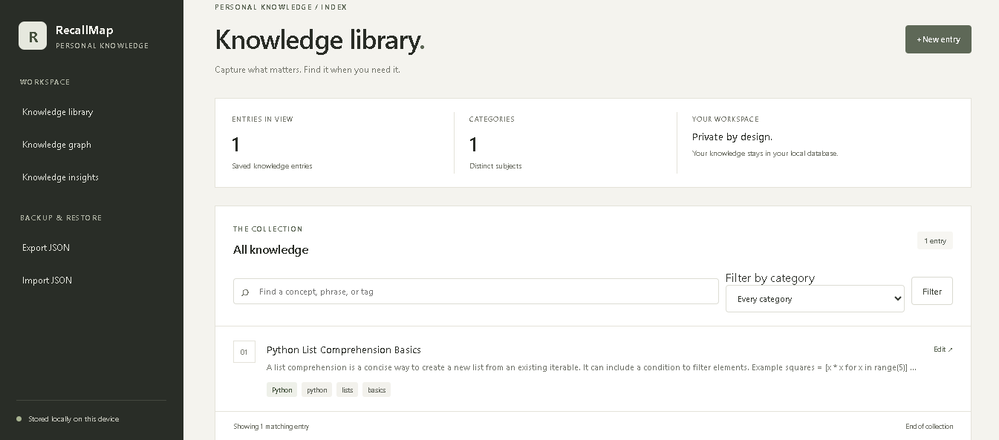
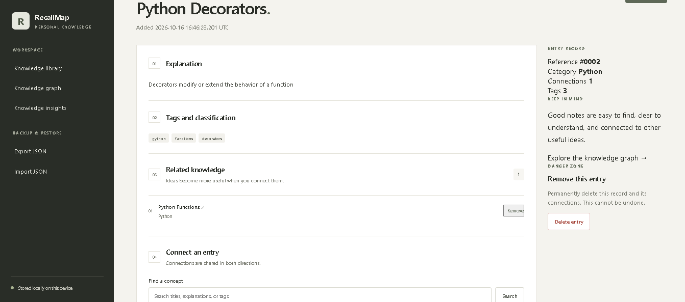
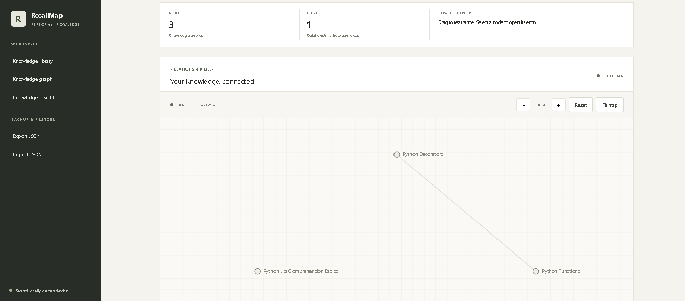
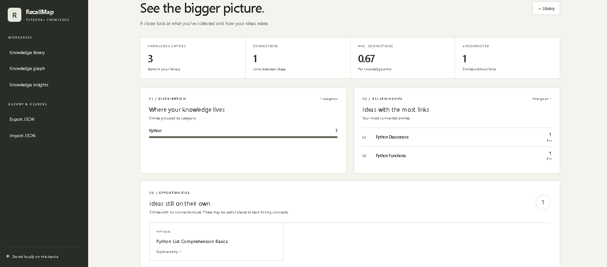

# RecallMap

**Your personal knowledge library, connected.**

RecallMap is a local-first knowledge management application built with Flask and SQLite. It helps you capture concepts, organize information, connect related ideas, and visualize how your knowledge fits together.

Instead of scattering notes across multiple files, RecallMap keeps your knowledge organized and searchable in one place.

## Features

- **Knowledge Library** — Create, view, edit, and delete knowledge entries.
- **Search & Filtering** — Find entries using keywords, categories, and tags.
- **Knowledge Connections** — Connect related entries to build a network of ideas.
- **Interactive Knowledge Graph** — Explore relationships between entries with an interactive graph.
- **Knowledge Insights** — View collection statistics, category distributions, connected entries, and isolated entries.
- **JSON Export & Import** — Back up your knowledge and restore it from JSON files.
- **Local SQLite Storage** — Keep your knowledge stored locally on your device.
- **Input Validation** — Validate entry data and handle application errors.

## Workflow Architecture

RecallMap follows a simple workflow in which users create, search, connect, and retrieve knowledge stored in a local database. The application also supports insights generation and JSON backup and restoration.



### Workflow Overview

1. **User Interaction:** Users create or search for knowledge through the interface.
2. **Application Processing:** Requests are validated and processed according to the requested operation.
3. **Data Storage:** Knowledge entries and their relationships are stored in the local database.
4. **Knowledge Retrieval:** Search, graph, and insights operations retrieve relevant information.
5. **Backup and Restore:** Users can export their knowledge as JSON or import a supported backup.

This workflow keeps knowledge management, relationship exploration, and data backup within a single local application.

## Screenshots

### 1. Knowledge Library

Browse, search, and organize your saved knowledge.



### 2. Entry Details

View explanations, categories, tags, and connections between entries.



### 3. Knowledge Graph

Explore relationships between concepts through an interactive graph.



### 4. Knowledge Insights

Understand your knowledge collection through statistics and category distributions.



## Tech Stack

| Technology | Purpose |
|---|---|
| Python | Application logic |
| Flask | Web framework |
| SQLite | Local database |
| HTML | Page structure |
| CSS | User interface and styling |
| JavaScript | Interactive knowledge graph |
| Pytest | Automated testing |

## Project Structure

```text
RecallMap/
├── app.py
├── config.py
├── database.py
├── requirements.txt
├── README.md
├── services/
│   └── knowledge_service.py
├── templates/
│   ├── base.html
│   ├── index.html
│   ├── entry_form.html
│   ├── entry_detail.html
│   ├── graph.html
│   ├── insights.html
│   ├── import.html
│   └── error.html
├── static/
│   └── style.css
├── tests/
│   └── test_knowledge.py
├── screenshots/
│   ├── Dashboard.png
│   ├── entry-detail.png
│   ├── knowledge_graph.png
│   └── insights.png
└── instance/
    └── recallmap.db
```

Note: The database is created locally when the application initializes. The structure above describes the main application files; additional files may exist in your project.

## Getting Started

### Prerequisites

- Python 3.12 or a compatible Python version
- pip
- Git (optional)

### 1. Clone the Repository

```bash
git clone <your-repository-url>
cd RecallMap
```

If you already have the project locally, open the `RecallMap` folder in VS Code instead.

### 2. Create a Virtual Environment

**Windows — PowerShell**

```powershell
python -m venv .venv
.\.venv\Scripts\Activate.ps1
```

If PowerShell blocks activation, run:

```powershell
Set-ExecutionPolicy -Scope Process -ExecutionPolicy Bypass
.\.venv\Scripts\Activate.ps1
```

### 3. Install Dependencies

```bash
python -m pip install -r requirements.txt
```

### 4. Run the Application

```bash
python app.py
```

Open the following URL in your browser:

[http://127.0.0.1:5000/](http://127.0.0.1:5000/)

Your local RecallMap workspace is now ready to use.

## How to Use RecallMap

### Create a Knowledge Entry

1. Open the Knowledge Library.
2. Click **New Entry**.
3. Enter a title and explanation.
4. Add a category and relevant tags.
5. Save the entry.

### Organize and Find Knowledge

1. Use the search field to find concepts.
2. Filter entries by category.
3. Open an entry to view its details.
4. Edit or delete entries when necessary.

### Connect Related Concepts

1. Open an existing entry.
2. Find the connections section.
3. Search for another entry and connect it.
4. Open the Knowledge Graph to explore the relationship.

### Explore Knowledge Insights

Open **Knowledge Insights** to view collection statistics, category distributions, and information about connected or isolated entries.

### Back Up and Restore Knowledge

- Select **Export JSON** to download a backup.
- Select **Import JSON** to restore data from a supported JSON backup.

Keep exported backups in a safe location. Verify the import behavior before importing the same backup repeatedly.

## Running Tests

Run the automated test suite from the project root:

```bash
python -m pytest -q
```

The current test suite has 17 passing tests.

Example output:

```text
.................                                      [100%]
17 passed
```

## Design Principles

- **Local-first:** Knowledge is stored in a local SQLite database.
- **Organized:** Categories, tags, and search make information easier to retrieve.
- **Connected:** Relationships reveal links between concepts.
- **Visual:** The graph and insights dashboard provide additional ways to explore knowledge.
- **Practical:** A focused interface for managing personal knowledge without unnecessary complexity.

## Future Improvements

Potential future enhancements include:

- Markdown support for knowledge explanations.
- Advanced search and sorting.
- Duplicate detection during JSON import.
- Improved graph filtering and navigation.
- Additional export formats.